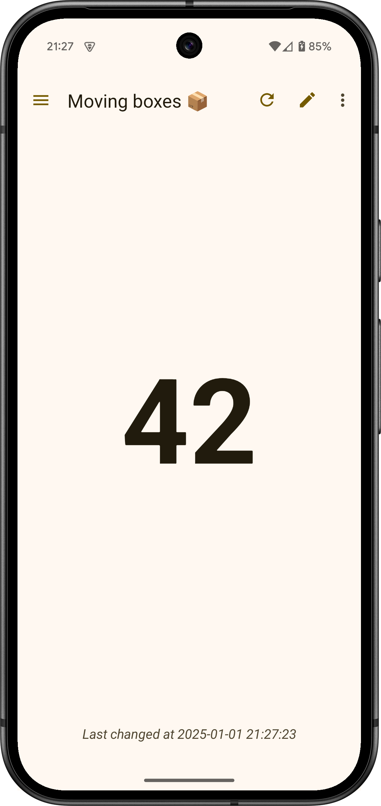
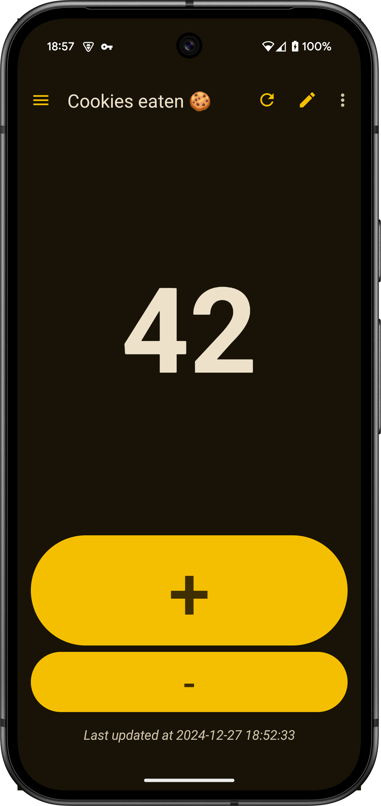
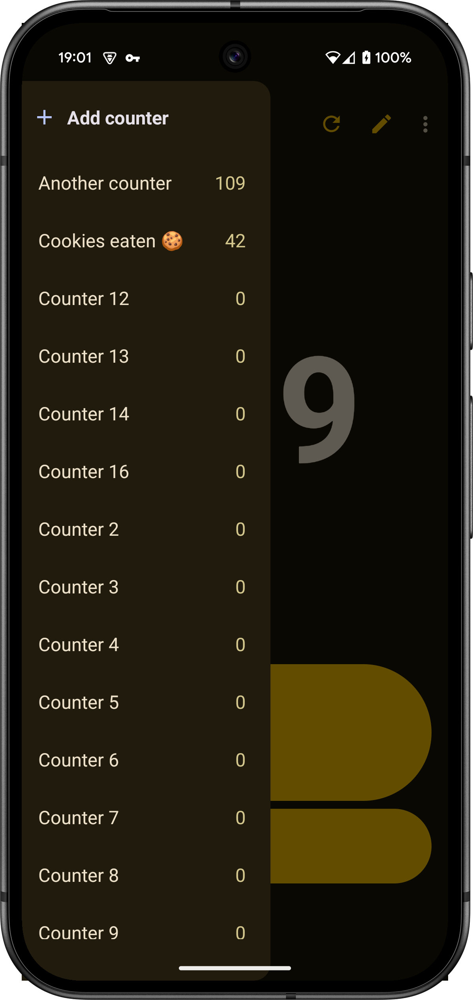
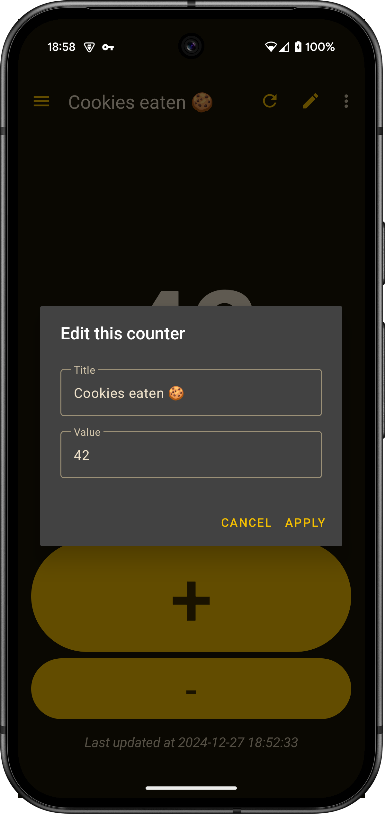
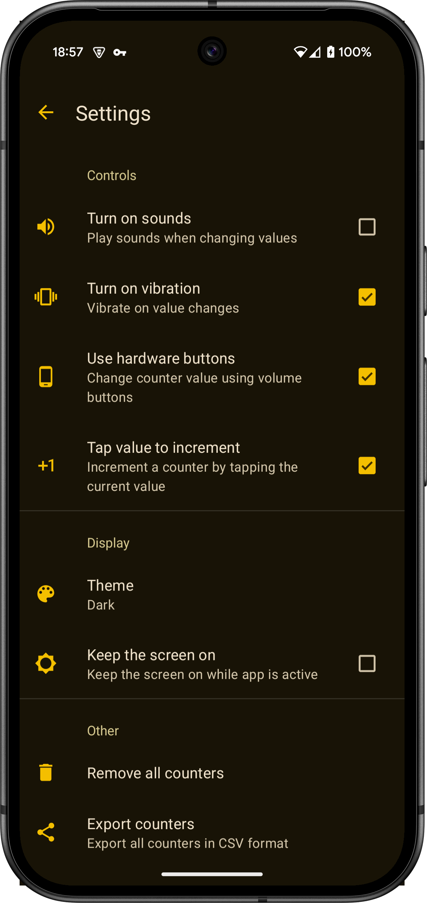

# Counter

Simple [tally counter](https://en.wikipedia.org/wiki/Tally_counter) for Android. Keep as many counters as you need, each with its own name and value. Count with the on-screen buttons, by tapping or swiping the number, with the volume keys, or from a home screen widget. Counters can be exported to and imported from CSV.

> [!WARNING]  
> **Note that the app is no longer available from the Google Play Store.** See [the section below](#google-play) for details.

---

&nbsp;&nbsp;&nbsp;&nbsp;&nbsp;&nbsp;&nbsp;&nbsp;&nbsp;&nbsp;&nbsp;&nbsp;&nbsp;&nbsp;&nbsp;&nbsp;

## Contributing

> [!IMPORTANT]
> **🚧 This app is not actively maintained.**

Feel free to make improvements, report issues, and create pull requests. If you want to help with
translation, go to project's [page on Crowdin](http://crowdin.net/project/simple-counter) (please,
don't translate resources directly).

## Credits

Huge thanks to all [contributors](https://github.com/gentlecat/counter/contributors)
and [translators](https://crowdin.net/project/simple-counter).

* Application icon made by @armand-leguillou
* Sounds from [adobeflash.com](https://www.adobeflash.com/download/sounds/clicks/)

## Google Play

Google decided to terminate my developer account for no apparent reason, so Counter is no longer available on the Play Store. I've never received any notices or warnings before this. Counter was the only app that I [published on the Play Store](https://web.archive.org/web/20250121131910/https://play.google.com/store/apps/details?id=me.tsukanov.counter) for over 12 years. Before removal, it was installed on over 500k active devices, was downloaded over 1 million times and had 4.5 rating with almost 6.5k reviews.

I tried going through the appeal process, but they refuse to tell me what the issue is. In fact, it seems like I'm forever banned from publishing anything on their store.

This is the notice which I received:

Some screenshots from my developer dashboard before I lost access to it:

